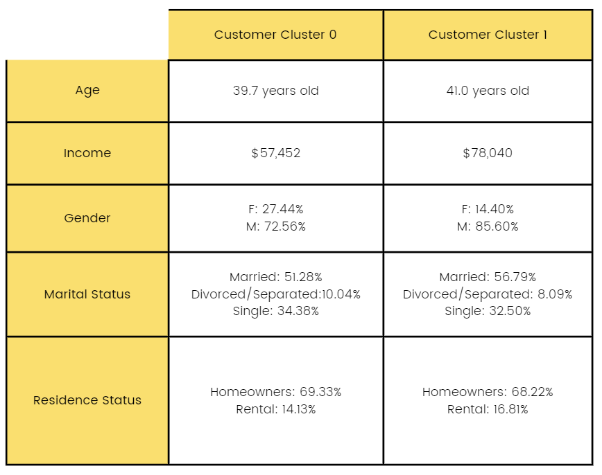
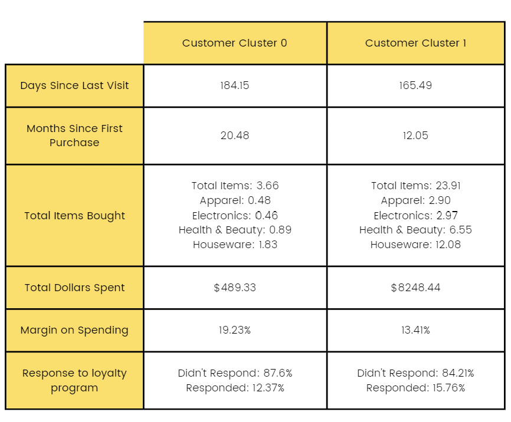

# Loyalty Program Segmentation

**Customer segmentation and promotion-response modeling for JC Dollars (JCD), a fashion retailer that put $10M+ into a loyalty program after several quarters of declining earnings.**


## Overview

JCD wanted to know who its loyal customers are, what drives them to respond to promotions, and how to target future campaigns. Using loyalty program data on **102,539 customers**, we:

1. explored how promotion responders differ from non-responders,
2. segmented customers with unsupervised clustering,
3. modeled promotion response (supervised) and six-month spend, and
4. turned the results into targeting recommendations for each segment.

## Key findings

- **Responses are rare:** only **1.2%** of customers responded to a promotion in the past year. The models had to be read with that imbalance in mind.
- **Two segments:** the elbow plot was inconclusive, but the silhouette and Calinski–Harabasz scores both peaked at **k = 2**. One segment is the more valuable one: higher income, newer and more recent visitors, higher spend and a slightly higher response rate.
- **What drives response:** customers are less likely to respond the longer it has been since their last visit and since their first purchase. Salaried and self-employed customers, and those buying housewares, are more likely to respond. Renters are less likely to respond, and divorced customers in one segment are more likely to.
- **Spend model:** a linear regression on six-month spend explains about half the variance (R² ≈ 0.5).
- **Department mix:** among responders, purchase counts in housewares, health & beauty, apparel and electronics each correlate above 0.7 with total purchases.

| Demographics by segment | Shopping behavior by segment |
| --- | --- |
|  |  |

## Recommendations

- **Re-engage lapsed visitors** with personalized offers, because days since the last visit is the strongest negative driver in both segments.
- **Target salaried and self-employed professionals**, who respond more often.
- **Win new customers early** with welcome offers and first-purchase discounts.
- **Promote higher-margin categories** and the four departments that drive total purchases.
- **Invest in personalized loyalty rewards** and a stronger online channel to compete with e-commerce players.

## Approach

| Step | Method |
| --- | --- |
| Pre-processing | Dropped customer ID; excluded income (over 5% missing) from the models; min-max scaled 19 numeric shopping features |
| Segmentation | k-means (k = 2–17, elbow, silhouette, Calinski–Harabasz) and hierarchical clustering (Ward) |
| Response model | Logistic regression on all customers and on each segment, with backward sequential feature selection |
| Spend model | Linear regression on total dollars spent in the last six months |

The Python scripts in `src/` cover EDA, clustering and the response models. The regression summary tables in the report were produced in R.

## Repository structure

```
├── assets/                                   README images
├── data/                                     customer-data.csv goes here (not committed)
├── reports/
│   └── jcd_loyalty_segmentation_report.pdf   full write-up
├── src/
│   ├── 01_eda_and_clustering.py              EDA, k-means and hierarchical clustering
│   ├── 02_segmentation_and_response_model.py segment profiles + logistic regression
│   ├── 03_response_model_numeric_features.py logistic regression on numeric features only
│   └── Proj Code- Numerical variable LR (1).txt
└── requirements.txt
```

## Getting started

```bash
git clone https://github.com/dhoniobond/loyalty-program-segmentation.git
cd loyalty-program-segmentation
python -m venv .venv
source .venv/bin/activate        # Windows: .venv\Scripts\activate
pip install -r requirements.txt
python src/01_eda_and_clustering.py
```

The scripts expect `data/customer-data.csv`. The dataset was provided by the company for coursework and is not redistributed here (see [data/README.md](data/README.md)).

## Team

**America's Next Top Modelers:** Moeez Abbas · Laura Seeger · Dhanush Srinath · Neeti Oberoi

*MISM 6206 — Modeling for Business, Northeastern University (Spring 2023)*
